# Raspberry Pi Car Head Unit (Android Auto)

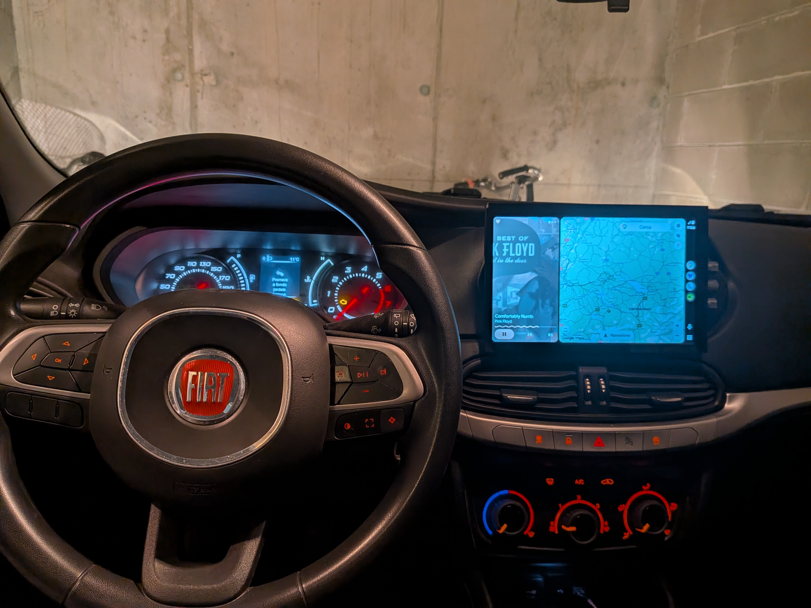

A custom car head unit based on a Raspberry Pi 5 and the open-source **[OpenDash](https://github.com/openDsh/dash)** software, bringing Android Auto, hands-free calls and a 10-inch touchscreen to a car whose original radio had very limited features.
The original radio has been relocated behind the glove compartment to preserve the parking-sensor functionality. For this purpose, a relay board switches the audio signal sent to the speakers between the factory unit and the new system. The switching is driven by the reverse-gear status, read from the CAN bus.
For easy and safe control of the new system, custom backlit steering-wheel buttons were designed and 3D-printed to look like the original ones; they let the user control media playback and perform other customizable actions.
To power up and shut down the system safely, a custom circuit board sends the shutdown signal to the Raspberry Pi and keeps the power on for a delay long enough for the shutdown to complete.

---

## Features

- **Android Auto** on a 12-inch touchscreen, running on a Raspberry Pi 5 with OpenDash.
- **Parking sensors preserved:** the original head unit stays in the car and takes over the speakers while the reverse gear is engaged.
- **CAN bus integration:** the reverse gear is read from the car CAN bus with an MKS CANable (CAN to USB) module and a Python script.
- **Safe power-up and shutdown:** a dedicated circuit senses the ignition, signals the Raspberry Pi to shut down, and keeps the power on for about 20 seconds while it does.
- **Clean audio:** USB DAC, isolation transformer against ground-loop noise, and an external amplifier.
- **Hands-free calls:** a microphone connected to the DAC, Bluetooth calls, and software echo cancellation with PipeWire.
- **Custom steering-wheel buttons:** eight backlit, 3D-printed buttons that replicate the original ones, connected over Bluetooth Low Energy.

---

## System Overview

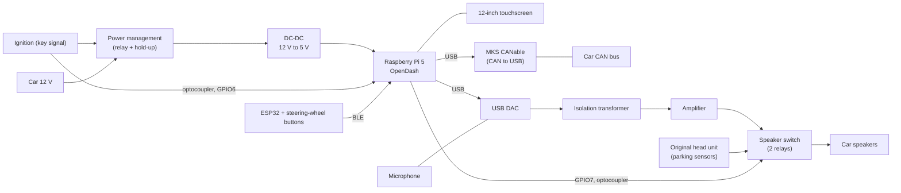

---

## Hardware

| Part | Notes |
| --- | --- |
| Raspberry Pi 5 | Main computer |
| DC-DC converter | 12 V to 5 V [link](https://www.amazon.it/dp/B07VQ89RZG?ref=ppx_yo2ov_dt_b_fed_asin_title)   |
| Touchscreen | 10 inch [link](https://it.aliexpress.com/item/1005001311947746.html) |
| USB DAC | Audio input and output [link](https://www.amazon.it/dp/B01N905VOY?ref=ppx_yo2ov_dt_b_fed_asin_title&th=1) |
| Isolation transformer | Between the DAC and the amplifier, to avoid ground-loop noise [link](https://www.amazon.it/dp/B06XQYN77L?ref=ppx_yo2ov_dt_b_fed_asin_title) |
| Amplifier | 2 channel stereo amplifier, 100W [link](https://www.amazon.it/dp/B08K47CC99?ref=ppx_yo2ov_dt_b_fed_asin_title)  |
| MKS CANable | CAN to USB module, reads the car CAN bus [link](https://it.aliexpress.com/item/1005008096206934.html) |
| ESP32 and 3D-printed buttons | Steering-wheel buttons [link](https://www.amazon.it/dp/B0CKR2ZXXW?ref=ppx_yo2ov_dt_b_fed_asin_title) |

---

## Schematic

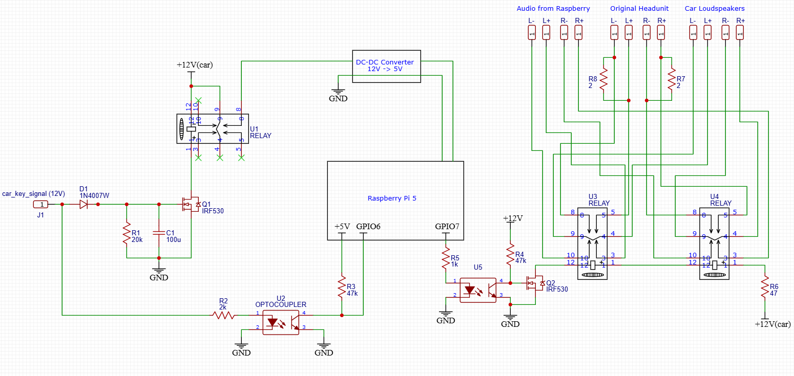

### Power management and safe shutdown

The ignition signal (`car_key_signal`, 12 V with the key on) is used in two ways:

- **Power hold-up:** through the diode D1 it charges the capacitor C1 and drives the gate of the MOSFET Q1 (IRF530), which energizes the relay U1. U1 connects the car 12 V to the DC-DC converter that powers the Raspberry Pi. When the key is switched off, D1 prevents C1 from discharging into the ignition line, so C1 can only discharge through R1. This keeps Q1 and the relay on for about 20 seconds, long enough for the Raspberry Pi to shut down cleanly.
- **Shutdown signal:** through R2 (2 kΩ) it drives the optocoupler U2, which isolates the 12 V ignition line from the Raspberry Pi. The output is pulled up by R3 (47 kΩ) and read on GPIO6: it is low with the key on and goes high when the key is switched off. This tells the Raspberry Pi to shut down while the hold-up circuit keeps it powered.

### Speaker switch for the parking sensors

The original head unit manages the parking sensors, and removing it triggers a warning on the dashboard. It was therefore unmounted from the dashboard, hidden behind the glove compartment, and rewired for the signals it needs. The car speakers are connected alternately to the Raspberry Pi amplifier or to the original head unit:

- **Relays U3 and U4:** one relay per channel (left and right). They switch the car speaker lines (L−, L+, R−, R+) between the audio from the Raspberry Pi and the original head unit.
- **Control:** GPIO7 drives, through R5 (1 kΩ) and the optocoupler U5, the MOSFET Q2 (IRF530), which switches the relay coils from the car 12 V. With GPIO7 low (Raspberry Pi off) the relays are energized and the speakers are connected to the original head unit. With GPIO7 high they are connected to the Raspberry Pi amplifier.
- **Reverse gear:** the Python script reads the reverse gear on the CAN bus. While it is engaged, GPIO7 goes low, so the speakers are connected to the original head unit and the parking sensors can be heard.
- **Dummy loads (R7, R8):** two 2 Ω resistors are always connected to the outputs of the original head unit, so that it always detects the speakers and does not report errors.

---

## Steering-Wheel Buttons

The car has steering-wheel controls, but none of them is for the head unit. A set of **eight backlit buttons** was designed and added to the empty slot on the right side of the steering wheel,, reproducing the look and feel of the originals. They control media playback, Google Gemini and full screen, and their functions can be customized.

The buttons were designed in **Onshape** and printed on a filament (FDM) 3D printer.

### Design Goals

- **Faithful to the original:** the shape, the proportions and the feel of the factory buttons are reproduced as closely as possible.
- **Easy to repair and modify:** every part can be removed and replaced on its own, and the design can be adapted to other buttons or symbols.

### Mechanical Design

- **Backplate:** the buttons are mounted on a printed backplate, which also works as an adapter for the original mounting on the steering wheel.
- **Button mechanics:** each button is supported by two feet and two springs, and presses a four-pin switch when pushed.
- **Illumination:** each button is lit by an LED, placed in a dedicated 3D-printed cylinder to diffuse light, tune the color and easily swap broken parts.
- **Symbols:** the buttons are printed in transparent PLA and painted black. Printed templates make it possible to remove the paint precisely with a screwdriver, which creates the backlit symbol on each button.

<table>
  <tr>
    <td>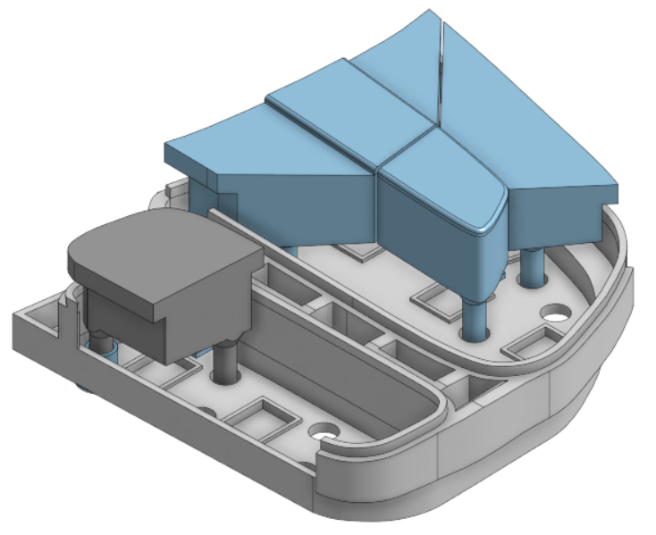</td>
    <td>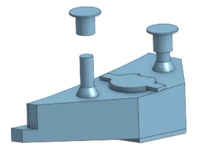</td>
    <td>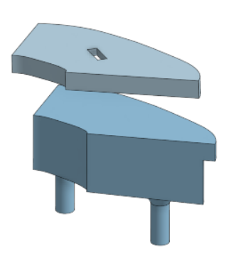</td>
  </tr>
  <tr>
    <td align="center">Buttons assembly</td>
    <td align="center">Button backside: LED insert and blocking pins</td>
    <td align="center">Button symbol template</td>
  </tr>
</table>

## Software

- **[OpenDash](https://github.com/openDsh/dash):** free and open source, a Qt-based infotainment application for Linux that embeds OpenAuto, used to run Android Auto.
- **Hands-free calls:** the phone is connected over Bluetooth; echo cancellation is implemented in software with PipeWire.
- **[Reverse-gear script](software/park_assist.py):** a Python script reads the CAN bus through the CANable module, detects when the reverse gear is engaged, and sets a GPIO pin to switch the speakers to the original head unit.
- **[Steering-wheel buttons](software/steering_buttons):** the ESP32 sends the button presses to the Raspberry Pi over BLE, where a Python script turns them into key presses for OpenDash.

---

## Photos

  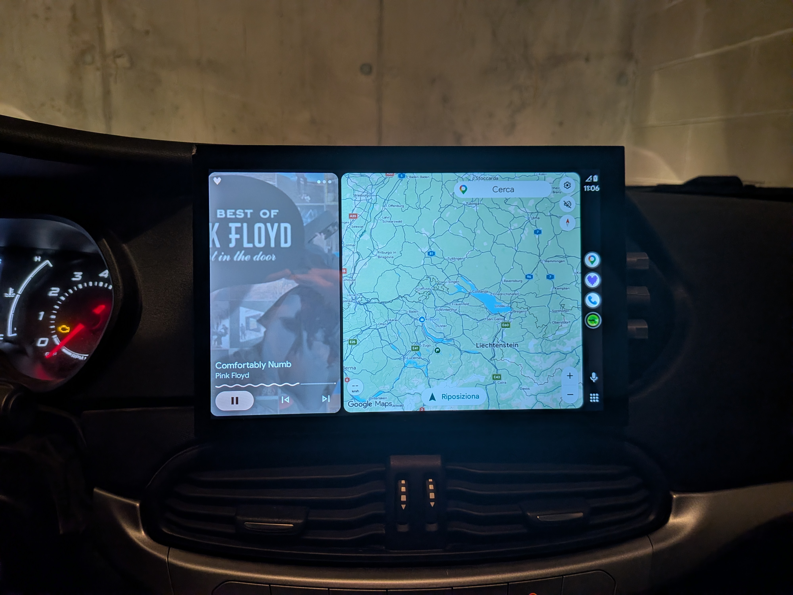 
  <em>Android Auto running through OpenDash.</em>

  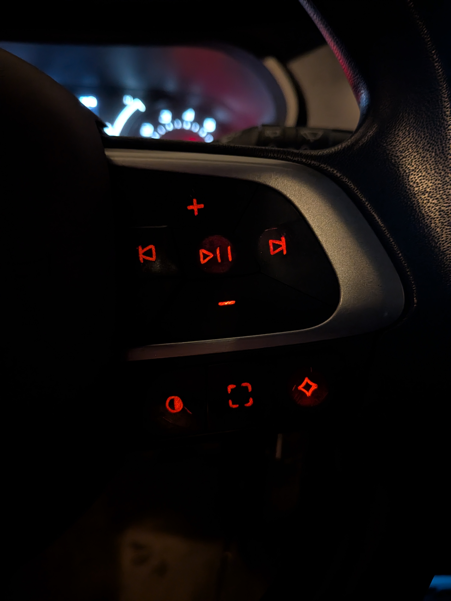 
  <em>The completed buttons, mounted on the steering-wheel.</em>

  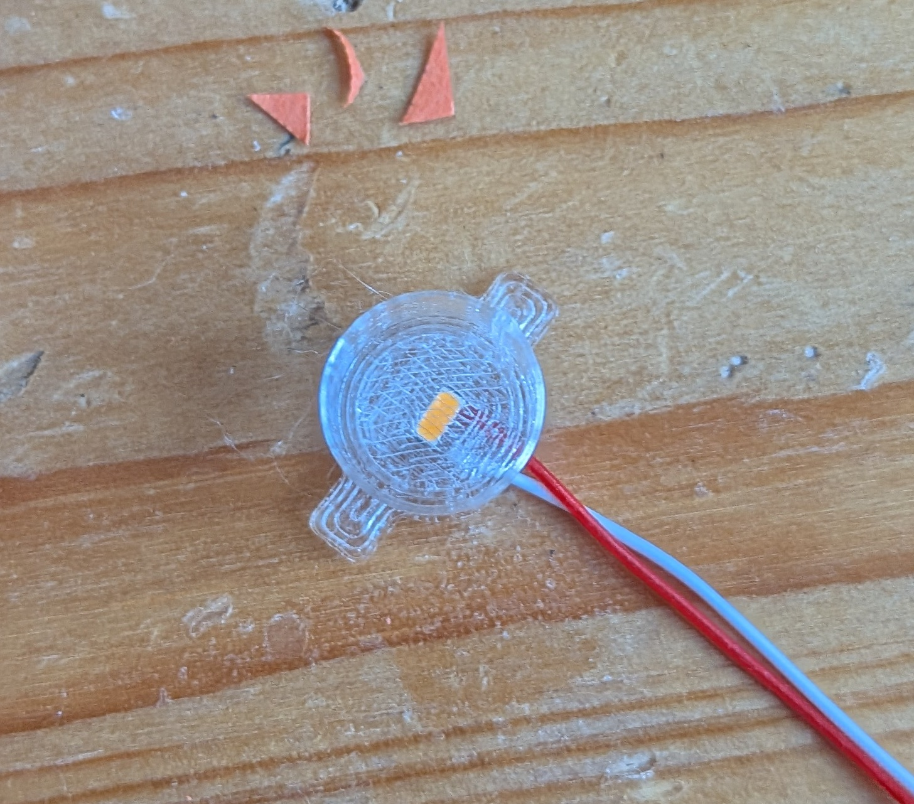 
  <em>An LED embedded in the 3D printer cylinder.</em>

  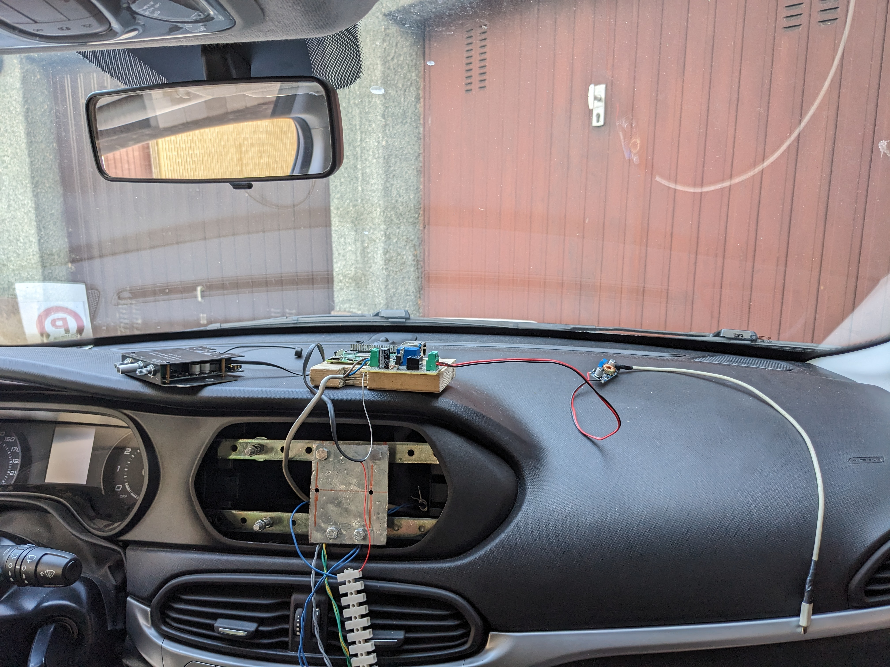 
  <em>The metal bracket used to hold the touchscreen in place. Magnets are used to easily attach e detach the monitor.</em>

  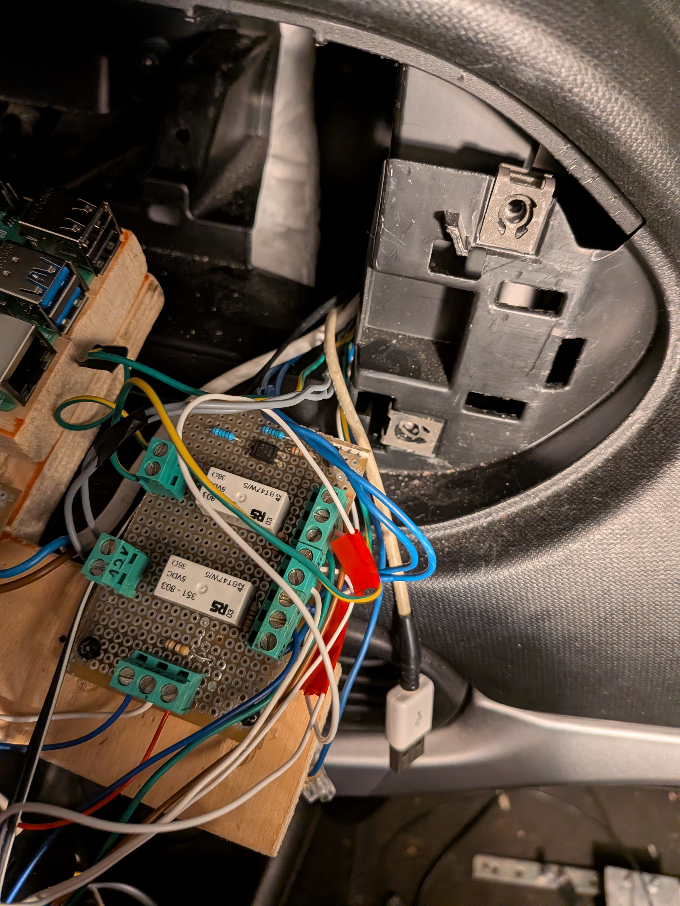 
  <em>The relay board that switches the speakers between the Raspberry Pi amplifier and the original head unit.</em>

